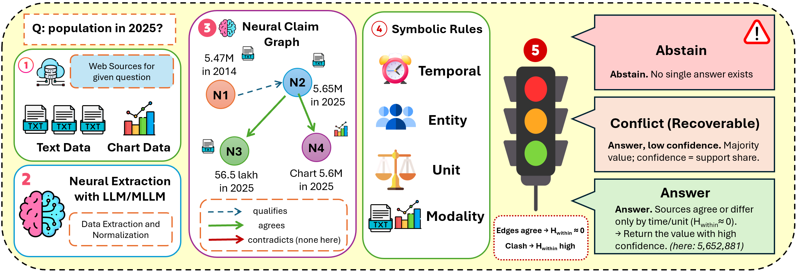
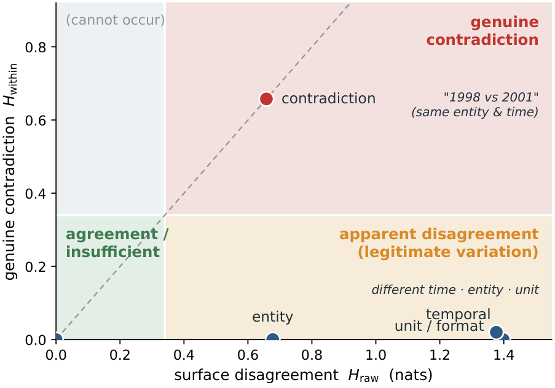
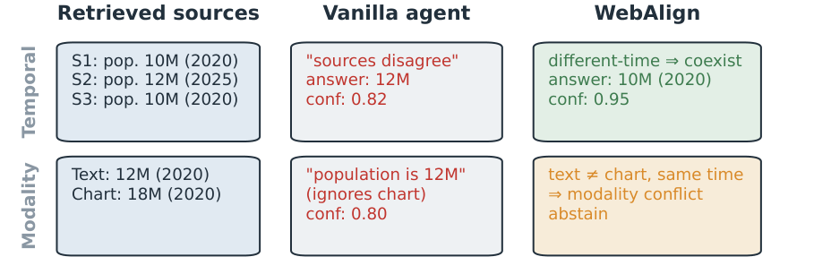
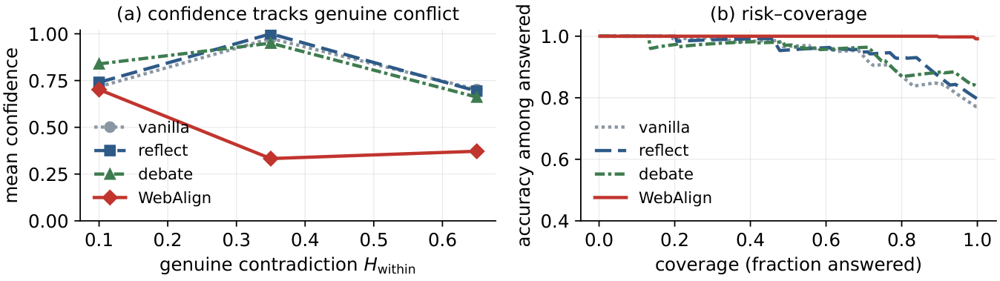

# WebAlign

**The Web Is Not a Knowledge Base: Measuring Epistemic Fragmentation in Multimodal Web Search**
Abhay Bhandarkar, Jagdish Bhandarkar

Web agents usually retrieve several pages and merge them into one answer, as if every page were an
independent vote. But pages that disagree are often not contradicting each other: they may report
the same fact at different times, in different units, about different entities that share a name,
or in a chart instead of prose. **WebAlign** decides how retrieved claims relate to one another
*before* answering, and abstains when the sources do not support a single answer.

> **Disagreement is not contradiction.**

<p align="center"></p>

An LLM (or a vision-language model, for charts) extracts one normalized claim per source. The
claims form a claim graph, and deterministic rules decide whether they can coexist. The result is
an answer, a low-confidence majority answer, or an abstention.

---

## Contents

| Path | What it contains |
|---|---|
| [`webalign/`](webalign) | The method: claim extraction, normalization, consistency rules, fragmentation measures, claim graph, agent |
| [`baselines/`](baselines) | Vanilla, RAG, reflection, debate, self-consistency, chain-of-verification, vision-language and NLI baselines |
| [`eval/`](eval) | Metrics, evaluation runners, rule ablation, and `reproduce_tables.py` |
| [`data/benchmark/`](data/benchmark) | The three benchmarks (WebFrag-Ctrl, WebFrag-Real, WebFrag-MM) and chart images |
| [`outputs/`](outputs) | Raw per-item predictions behind Tables 2, 3, 5, and 6a of the paper |
| [`llm/`](llm) | A small OpenAI-compatible client with an on-disk response cache |
| [`configs/models.yaml`](configs/models.yaml) | Model and endpoint configuration |
| [`tests/`](tests) | Unit tests for the symbolic layer (no model needed) |

## Installation

Python 3.10 or newer.

```bash
git clone https://github.com/AbhayBhandarkar/webalign.git
cd webalign
pip install -r requirements.txt
```

All commands below are run from the repository root.

## Quick start (no GPU, no API key)

**Reproduce the paper's tables from the released outputs:**

```bash
python -m eval.reproduce_tables
```

This rescores the files in `outputs/` against the gold labels in `data/benchmark/` and prints
Tables 2, 3, 5, and 6a of the paper.

**Run the symbolic-layer tests:**

```bash
python -m tests.test_symbolic
```

**Use the symbolic layer directly:**

```python
from data.schema import Claim, Qualifier
from webalign.consistency import classify_slot
from webalign.entropy import fragmentation

claims = [
    Claim("Norway", "population", "5.47 million", "S1", Qualifier(time="2014")),
    Claim("Norway", "population", "5,652,881",    "S2", Qualifier(time="2025")),
]
print(classify_slot(claims).conflict_type)   # ConflictType.TEMPORAL_CHANGE, not a contradiction
print(fragmentation(claims))                 # h_raw > 0, h_within = 0
```

## The method

### Claims

Each source is reduced to one claim about the queried subject and predicate:

```
(subject, predicate, value, qualifier{time, location, unit}, source, modality)
```

Extraction is done by an LLM for text and by a vision-language model for charts
([`webalign/extract.py`](webalign/extract.py)). Normalization
([`webalign/normalize.py`](webalign/normalize.py)) parses numbers (including scales such as
*million*, *lakh*, and *crore*), turns dates into intervals, and canonicalizes strings. If a
source contains a cue that tells same-name entities apart (for example "(IL)" vs "(MA)"), the
extractor records it and the claim is linked to that entity.

### Fragmentation measures

Let `Ṽ` be a claim's raw value, `V` its normalized value, and `G` its context, keyed by
(linked entity, time). With source-weighted distributions
([`webalign/entropy.py`](webalign/entropy.py)):

| Quantity | Definition | Meaning |
|---|---|---|
| `H_raw` | `H(Ṽ)` | Surface disagreement: entropy of raw values, ignoring context |
| `H_within` | `Σ_g p(g) · H(V \| G=g)` | Genuine contradiction that remains inside a single context |
| `H_between` | `H(G)` | Spread across contexts (different times or entities) |
| `Δ` | `H_raw − H_within = [H(Ṽ) − H(V)] + I(V; G)` | Apparent disagreement: the part removed by normalization plus the part explained by context |

Contradiction raises `H_within`. Temporal and entity variation raise `H_raw` and `H_between`
but leave `H_within ≈ 0`. Unit variation sits in a single context, so all of its `Δ` comes from
normalization.

<p align="center"></p>

In the output files, `frag.h_true` is the paper's `H_within`.

### Consistency rules

[`webalign/consistency.py`](webalign/consistency.py) decides each slot's epistemic state with
four deterministic rules:

| Rule | Decision |
|---|---|
| Unit / tolerance | Numeric values within 0.5% relative tolerance are the same value |
| Temporal | Values that differ only across non-overlapping time qualifiers *qualify* each other; they do not conflict |
| Entity | The same name linked to different entities is an *ambiguity*, not a conflict |
| Modality | A text value that disagrees with a co-referring chart value is a *modality conflict* |

Whatever remains is a genuine text conflict.

### Decision

[`webalign/agent.py`](webalign/agent.py) maps the state to an output:

| State | Output |
|---|---|
| Agreement, unit variation | Answer |
| Temporal change | Answer for the queried time |
| Text or modality conflict with a clear majority | Majority answer, flagged as a conflict; confidence = majority support share |
| Text or modality conflict without a majority | Abstain, flagged as a conflict |
| Entity ambiguity, or no value extracted | Abstain |

**Confidence is a rule-assigned score, not a calibrated probability.** It ranks answers well
(risk–coverage AUC 0.998), but WebAlign's expected calibration error (0.139) is higher than that
of every baseline except self-consistency. Use it for ranking and abstention, not as a
probability estimate.

<p align="center"></p>

## Benchmarks

All files are JSON Lines in [`data/benchmark/`](data/benchmark).

| File | Items | Description |
|---|---|---|
| `webfrag_ctrl.jsonl` | 737 | **WebFrag-Ctrl**: multi-source items built from real Wikidata facts, each with an injected epistemic state |
| `webfrag_ctrl_subset.jsonl` | 205 | Stratified subset used for the 16-model study (30 per state; all 25 entity items) |
| `webfrag_real.jsonl` | 160 | **WebFrag-Real**: AmbigQA questions; single-answer questions become answerable items, multi-answer questions become unanswerable ones (80 / 80) |
| `webfrag_mm.jsonl` | 80 | **WebFrag-MM**: text sources plus a rendered chart that agrees (40) or conflicts (40) with the text |
| `images/` | 80 | The charts referenced by WebFrag-MM |

WebFrag-Ctrl composition:

| State | Items | Answerable |
|---|---|---|
| Agreement | 118 | yes |
| Text conflict, recoverable (clear majority) | 119 | yes |
| Text conflict, unresolvable (no majority) | 115 | no |
| Temporal change | 120 | yes (for the queried year) |
| Unit / tolerance | 120 | yes |
| Entity ambiguity | 25 | no |
| Insufficient evidence | 120 | no |

Each item looks like this (abridged):

```json
{
  "qid": "ent_Q28515_Q49158",
  "question": "In what year was Springfield founded?",
  "subject": "Springfield",
  "predicate": "founded_in",
  "sources": [
    {"id": "Source1", "text": "Source1 notes Springfield (capital city of the U.S. state of Illinois ...) dates back to 1821.", "image_path": null, "modality": "text"},
    {"id": "Source2", "text": "Source2 reports that Springfield (county seat of Hampden County, Massachusetts ...) was established in 1636.", "image_path": null, "modality": "text"}
  ],
  "gold_answer": null,
  "gold_answerable": false,
  "gold_conflict_type": "entity_ambiguity",
  "gold_entropy": 0.0,
  "meta": {"h_raw": 0.636514, "h_between": 0.636514}
}
```

Fields starting with `gold_` and the entropy values in `meta` come from benchmark construction and
are used **only for scoring**. No method reads them at inference time.

## Raw outputs

[`outputs/`](outputs) contains one file per method and model, named `<method>__<model>.jsonl`:

| Directory | Contents | Paper |
|---|---|---|
| `webfrag_ctrl/` | All nine methods with Qwen2.5-32B; vanilla, reflection, and WebAlign with Qwen2.5-72B (n = 737) | Tables 2, 3, 5 |
| `webfrag_ctrl_subset/` | Vanilla, reflection, and WebAlign for the other 14 models (n = 205) | Table 5 |
| `webfrag_real/` | Vanilla, reflection, neural-only, and WebAlign with Qwen2.5-32B (n = 160) | Table 6a |

Each line is one prediction:

```json
{"qid": "agr_Q117507", "method": "webalign", "agent": "qwen2.5-32b", "answer": "1955",
 "answerable": true, "conflict_detected": false, "confidence": 0.95,
 "conflict_type": "agreement", "rationale": "Sources agree after normalization.",
 "frag": {"h_raw": 0.0, "h_true": 0.0, "delta_apparent": 0.0, "h_true_norm": 0.0}}
```

For the baselines, a method *flags a conflict* when its JSON reply sets
`sources_disagree: true`, and *abstains* when it sets `answerable: false` or returns no answer.
Replies that cannot be parsed count as abstentions.

Tables 4 (rule ablation) and 6b (cross-modal) require model calls and can be regenerated with the
commands below.

## Running models

WebAlign and every baseline talk to models through the OpenAI chat-completions protocol, so the
same code drives a local [vLLM](https://github.com/vllm-project/vllm) server or any hosted
OpenAI-compatible endpoint. Models are registered by name in
[`configs/models.yaml`](configs/models.yaml).

**Local models (as in the paper):**

```bash
vllm serve Qwen/Qwen2.5-32B-Instruct-AWQ --port 8000          # text agent and extractor
vllm serve Qwen/Qwen2.5-VL-7B-Instruct  --port 8001           # chart extractor and vision baseline
```

**Hosted models:**

```bash
export WEBALIGN_API_BASE=https://your-endpoint/v1
export WEBALIGN_API_KEY=...
```

Set each hosted agent's `model` field in `configs/models.yaml` to the identifier your provider
uses. Agents marked `reasoning: true` get a larger token budget and no temperature override.
Decoding is deterministic (temperature 0) wherever the model allows it. Every response is cached
in `.cache/llm/`, so reruns are free and reproducible.

**Evaluate methods on a benchmark:**

```bash
python -m eval.run_eval --items data/benchmark/webfrag_ctrl.jsonl --agents qwen2.5-32b \
    --methods vanilla rag reflect debate self_consistency cove nli neural_only webalign
```

Predictions are written to `runs/<method>__<model>.jsonl` and scores are printed. Use
`--items data/benchmark/webfrag_ctrl_subset.jsonl --agents gpt-4o ...` for the cross-model
setting and `--limit N` for a quick check.

**Rule ablation (Table 4):**

```bash
python -m eval.ablation --spec qwen2.5-32b
```

**Cross-modal study (Table 6b):**

```bash
python -m eval.run_multimodal
```

## Main results

WebFrag-Ctrl, Qwen2.5-32B, n = 737 (full table: `python -m eval.reproduce_tables`):

| Method | Accuracy ↑ | False-contradiction rate ↓ | Consistency awareness ↑ | ECE ↓ |
|---|---|---|---|---|
| Vanilla | 0.811 | 0.328 | 0.492 | 0.099 |
| Reflection | 0.828 | 0.075 | 0.558 | 0.095 |
| Debate | 0.860 | 0.306 | 0.658 | 0.033 |
| Chain-of-verification | 0.855 | 0.060 | 0.638 | 0.080 |
| **WebAlign** | **0.989** | **0.019** | **0.988** | 0.139 |

*False-contradiction rate*: share of temporal, unit, and entity items flagged as conflicts.
*Consistency awareness*: share of unanswerable items on which the method abstains.

- Across **16 models from 9 vendors**, standard agents read legitimate variation as contradiction
  8–55% of the time; WebAlign keeps it at or below 2% for every model.
- Reflection prompting also lowers false contradictions on frontier models, but its correct-abstention
  rate varies from 0.19 to 0.99. WebAlign has the highest abstention rate on 12 of the 16 models.
- A vision-language model that sees the chart flags 2 of 40 text–chart conflicts; WebAlign flags 36.

<p align="center"></p>

## Limitations

- Sources are templated so the ground truth is exact; the controlled categories match WebAlign's
  rules by design. WebFrag-Real is the only set with naturally occurring answers. Evaluation on
  human-annotated real web pages is future work.
- The entity rule needs a disambiguating cue in the text. Without one, same-name claims are
  treated as a possible conflict.
- Support is counted per source; copied or syndicated pages are not merged.
- Disagreements about how a question should be read (rather than about time, unit, entity, or
  modality) fall outside the four rules.

## Citation

```bibtex
@inproceedings{bhandarkar2026webalign,
  title     = {The Web Is Not a Knowledge Base: Measuring Epistemic Fragmentation in Multimodal Web Search},
  author    = {Bhandarkar, Abhay and Bhandarkar, Jagdish},
  booktitle = {ACM WebSciX 2026},
  address   = {Bengaluru, India},
  year      = {2026}
}
```

## License

Released under the [MIT License](LICENSE).
